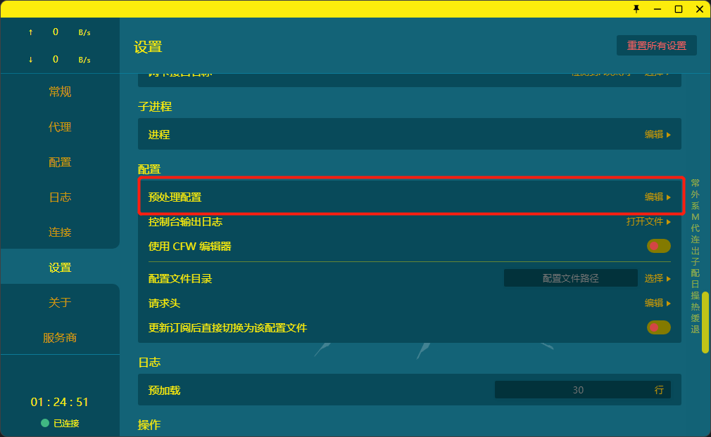
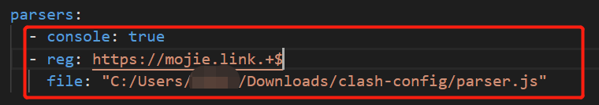
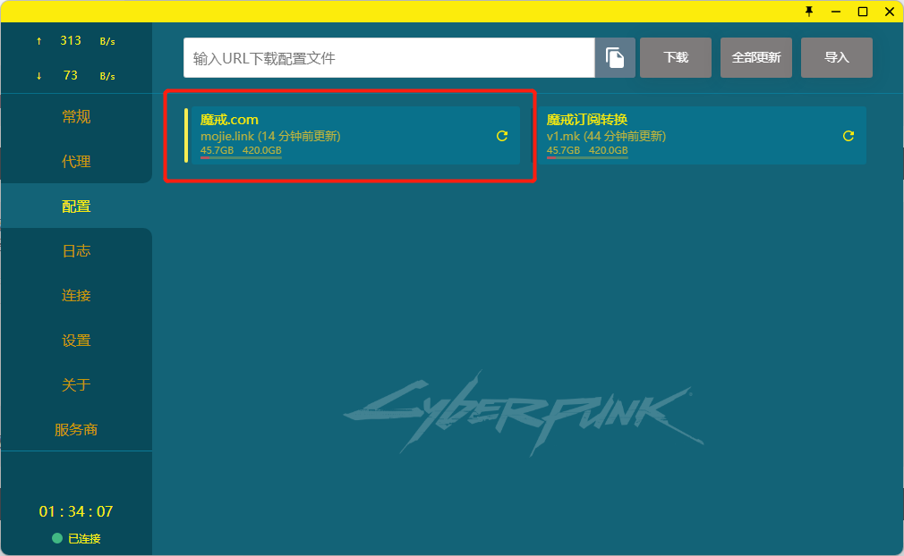
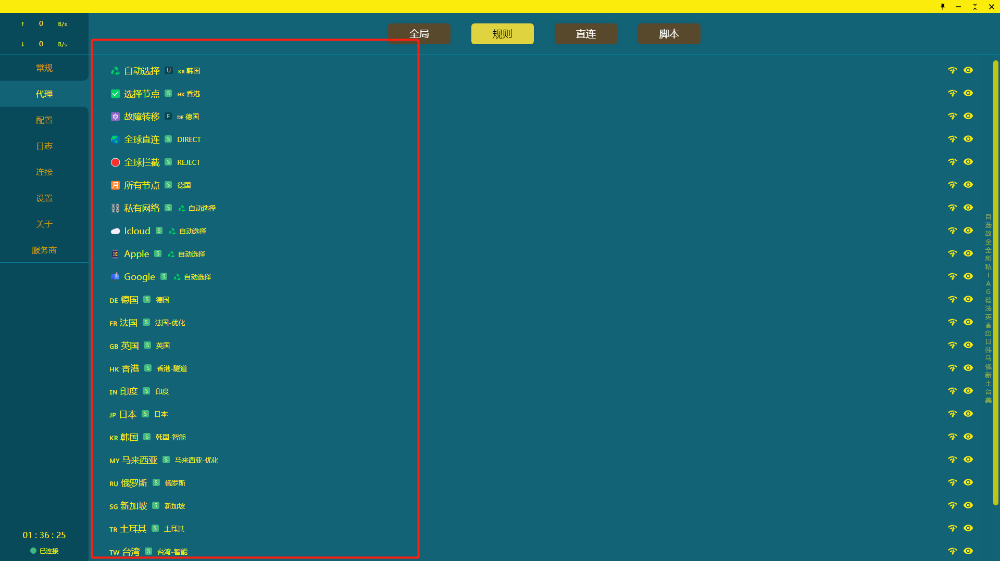
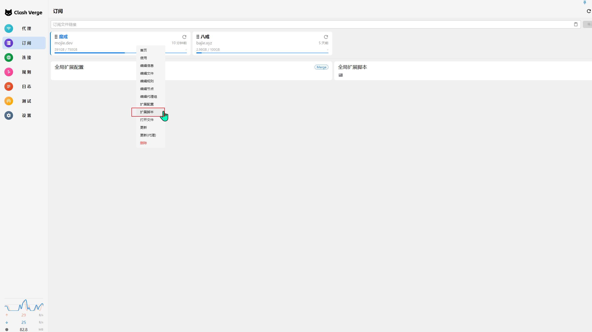

# 使用

## clash-for-windows

*我使用的是汉化的，但是位置一样*

**分流规则使用[clash-rules](https://github.com/Loyalsoldier/clash-rules)**

### 1.编辑配置

#### 设置-预处理配置

#### 2.在配置文件中添加配置

*注意yml格式。在：后面有一个空格*  
console:是否开启日志，如果不是开发者就不需要这个配置  
reg:正则匹配，可以换成其他网址  
file:parser.js的路径，替换成自己电脑的即可  

#### 3.更新订阅

关闭第一步打开的配置文件后，直接去更新订阅即可。

#### 4.查看转换后的订阅

## clash-verge

### 1.右键编辑

### 代码

打开文件，复制其中的代码，根据教程可以做微调

[脚本文件](./clash-verge/扩展脚本config.js)

### 文档

[文档地址](https://www.clashverge.dev/guide/extend.html)

## FlClash

### 1. 添加覆写脚本

1. 打开 FlClash，进入「配置 (Profiles)」。
2. 点击对应的订阅配置项，选择「覆写 (Override)」或「脚本 (Script)」。
3. 将 [`flclash/flclash-override.js`](./flclash/flclash-override.js) 代码复制并保存。
4. 重新加载/更新订阅即可生效。

### 2. Tailscale 共存 / 按需接入

脚本顶部 `TAILSCALE_MODE` 二选一，同一份脚本可在不同设备上分别设值：

| 取值 | 适用设备 | 行为 |
| --- | --- | --- |
| `direct`（默认） | 已装官方 Tailscale（Windows / 桌面） | `100.64.0.0/10`、`fd7a:115c:a1e0::/48`、`ts.net`、`tailscale.com`、`tailscale.io` 一律直连；`+.ts.net` 走 fake-ip 例外并固定查询 `100.100.100.100`；其他设备可反向连入本机 |
| `outbound` | 不装官方 Tailscale（Android 单 VPN 槽位） | 注入 `type: tailscale` 出站节点与 `Tailscale` 策略组（默认节点，可手动切直连）；`ts.net` 经 fake-ip 交给 tsnet 的 MagicDNS；**仅出站，其他设备无法连入本机** |

- `outbound` 需要 FlClash ≥ 0.8.93（mihomo ≥ 1.19.25），低版本会因未知节点类型拒绝加载。
- 节点参数在 `TAILSCALE_NODE`：`hostname` 改成设备名；`authKey` 可留空，首次命中时按 FlClash 日志中的登录链接授权（避免 key 明文进入备份）。
- `direct` 模式**不会**出现 Tailscale 分组，这是预期行为；只有 `outbound` 才注入节点和分组。改完脚本后记得在订阅的「覆写」里重新选中该脚本并刷新订阅。

### 3. 分组规模

脚本顶部 `GROUP_LAYOUT`：

| 取值 | 分组 |
| --- | --- |
| `compact`（默认） | 节点选择、AI（含 OpenCode）、自动选择、直连、各地区-自动、媒体、社交、系统、开发者、广告拦截（`outbound` 模式再加 Tailscale） |
| `full` | 每个服务独立成组，保留地区手动组、故障转移与拒绝组；OpenCode 规则并入 AI 组 |

`compact` 合并关系：OpenCode + Claude + ChatGPT/Gemini 等 + Copilot → AI；YouTube + Google + 流媒体 → 媒体；Telegram + 社交 → 社交；微软 + 苹果 → 系统。地区手动组与对应的 `地区-自动` 内容重复，精简布局只保留自动组。

### 4. 分组图标

每个分组都带 `icon`（mihomo 的分组图标字段），FlClash 在「代理」页切换到**列表**样式时显示在分组标题左侧。图标来自 [Qure](https://github.com/Koolson/Qure)，由脚本顶部的 `ICON_BASE` 统一拼接；地区图标取自 `REGIONS[].icon`。

- 想换图标：修改 `ICON_BASE` 或对应分组的 `icon` 值即可，支持 PNG / SVG / `data:image/...;base64,...`。
- 图标由 FlClash 联网拉取并缓存，首次显示可能有短暂占位；若图标地址不可达，会回退为分组名首字。
- 只改了图标不会影响分流；更新脚本后同样需要重新选中脚本并刷新订阅。

### 5. 界面上看不到分组

脚本生效后，配置里确实有全部分组（点击仪表盘的当前配置卡片可核对分组数）。FlClash 的「代理」页把分组做成顶部横向标签条，并会**自动滚动到上次选中的分组**；旧订阅若选中过同名的「广告拦截」，它在重建后的列表里位于最后，首屏就只显示右侧的几个组。

- 在标签条上向左拖动 / 横向滚动，或点右侧下拉箭头并向上滚动，即可看到「节点选择」「AI」「自动选择」。
- 点一次「节点选择」，FlClash 会记住该选择，下次直接打开在首组。
- `direct` 模式没有 Tailscale 分组是预期行为（见上一节）；不要为了看到分组改成 `outbound`，Windows 已运行官方 `tailscaled` 时两者会冲突。