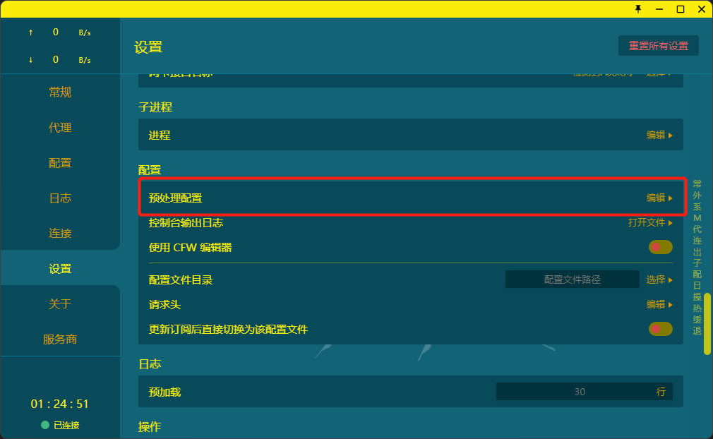
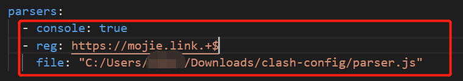
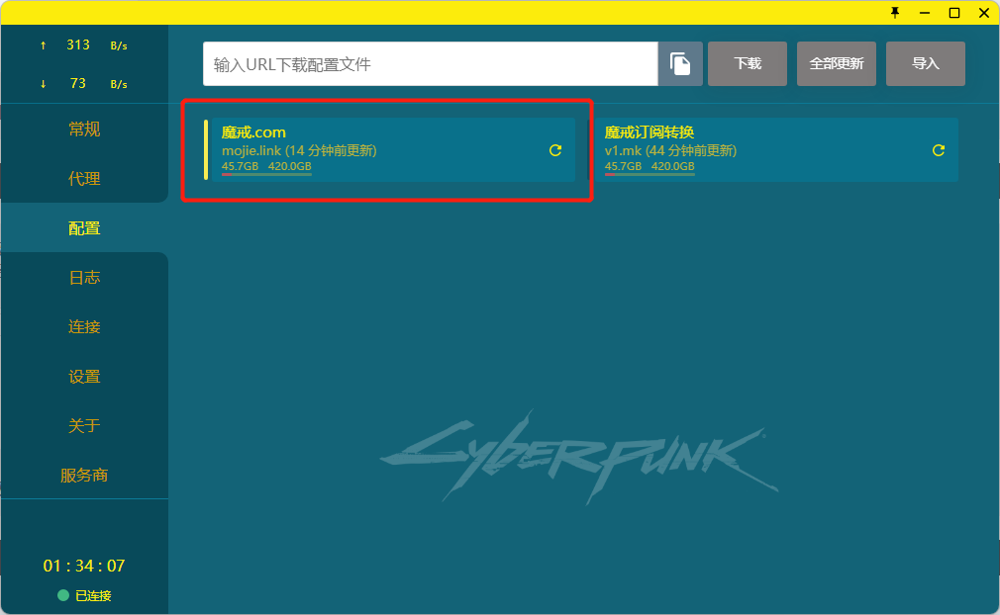
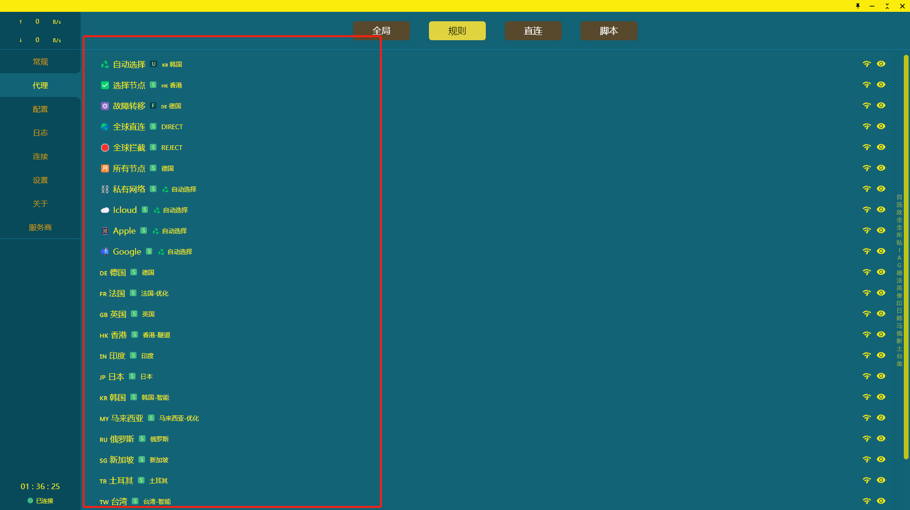
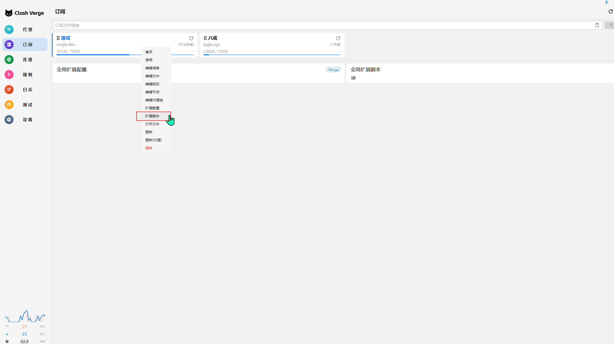

# 使用

## clash-for-windows

*我使用的是汉化的，但是位置一样*

**分流规则使用[clash-rules](https://github.com/Loyalsoldier/clash-rules)**

### 1.编辑配置

#### 设置-预处理配置

#### 2.在配置文件中添加配置

*注意yml格式。在：后面有一个空格*  
console:是否开启日志，如果不是开发者就不需要这个配置  
reg:正则匹配，可以换成其他网址  
file:parser.js的路径，替换成自己电脑的即可  

#### 3.更新订阅

关闭第一步打开的配置文件后，直接去更新订阅即可。

#### 4.查看转换后的订阅

## clash-verge

### 1.右键编辑

### 代码

打开文件，复制其中的代码，根据教程可以做微调

[脚本文件](./clash-verge/扩展脚本config.js)

### 文档

[文档地址](https://www.clashverge.dev/guide/extend.html)

## FlClash

### 1. 添加覆写脚本

1. 打开 FlClash，进入「配置 (Profiles)」。
2. 点击对应的订阅配置项，选择「覆写 (Override)」或「脚本 (Script)」。
3. 将 [`flclash/flclash-override.js`](./flclash/flclash-override.js) 代码复制并保存。
4. 重新加载/更新订阅即可生效。

### 2. 分流规则与命中顺序

规则自上而下匹配，**首个命中生效**：

| 顺序 | 规则 | 去向 |
| --- | --- | --- |
| 1 | Tailscale 网段、`ts.net`、`tailscale.com`、`tailscale.io` | 直连（`outbound` 模式走 Tailscale 组） |
| 2 | 本机与内网（`.lan`、`.local`、私有 `IP-CIDR`） | 直连 |
| 3 | `EXTRA_DIRECT_RULES` 补充直连 | 直连 |
| 4 | 各服务的 `priority` 放行规则 | 对应服务组 |
| 5 | 统计上报残留子域（GA/GTM 后缀） | 广告拦截 |
| 6 | `RULE-SET,Reject`（Loyalsoldier 广告表，20.4 万条域名） | 广告拦截 |
| 7 | 各服务的 `rules`（手写精确规则） | 对应服务组 |
| 8 | 各服务的 `sets`（`Google` / `ICloud` / `Apple` / `Telegram` 分类集） | 对应服务组 |
| 9 | 兜底 | 按 `ROUTING_MODE` 分叉，见下表 |

前八条两种模式共用，尾部兜底由脚本顶部的 `ROUTING_MODE` 决定——名字说的是**兜底往哪走**，不是列表里装了谁：

| `ROUTING_MODE` | 尾部规则 | 效果 |
| --- | --- | --- |
| `proxy-if-matched`（默认） | `EXTRA_PROXY_RULES` → `RULE-SET,GFW` → `RULE-SET,GreatFire` → `RULE-SET,TldNotCN` → `RULE-SET,ProxyList` → `MATCH,直连` | 命中规则的才走代理：只有服务表、拒绝集与墙站表里的站花代理流量，其余一律直连 |
| `direct-if-matched` | `RULE-SET,Private` → `RULE-SET,Direct` → `RULE-SET,LanCIDR` → `RULE-SET,CNCIDR` → `DOMAIN-SUFFIX,cn` → `GEOIP,CN` → `MATCH,节点选择` | 命中直连规则的才直连：判不出是国内的都走代理，被墙的站一个不漏 |

旧值仍认：`'whitelist'` 等价 `proxy-if-matched`，`'geo'` 等价 `direct-if-matched`。

八个坑决定了这张表的顺序：

- **拒绝集必须在服务放行之后。** `reject.txt` 把 `ogads-pa.clients6.google.com` 整条列为广告，而它是 Gemini 的人机校验端点，被 `REJECT` 后 Gemini 直接 403。`service.priority` 就是给这类误杀留的放行通道，规则会插到 `RULE-SET,Reject` 之前，并在 DNS 里按该服务组解析。
- **统计上报不能一概直连。** `google-analytics.com` 后缀下 `www` 在国内有可达端点（`211.95.34.129`，直连返回 204），`region1` 却是被墙的 `216.239.x`。所以精确域名走直连、后缀整段送广告拦截，别让请求挂在直连里等超时。
- **`GEOIP,CN` 只能判「解析出来的 IP 在国内」。** 对 Cloudflare 前置的国内站（解析到 `104.21.x` / `172.67.x`）完全无效，也判不出只有 AAAA 记录的域名——脚本里 `dns.ipv6: false`，拿不到 IPv4 就没法走 GEOIP。这两种情况只能靠域名规则命中。
- **手写规则永远排在规则集之前。** 服务分流是 `rules` → `sets`，`EXTRA_DIRECT_RULES` 也排在 `RULE-SET,Direct` 之前：手写那条是「我知道这一条必须这样」，规则集是「大概这样」。上游哪天把 `deepseek.com` 从 `direct.txt` 里删掉，脚本里那条补丁还在。
- **没有任何规则库知道「这个境外 IP 在国内通不通」。** IP 段库只说归属，域名库只说分类，可达性不在路由数据里（GFW 也不发布阻断表）。所以 `api14.wendingai.future1.us`（`3.25.52.22`，AWS，直连 `/v1/models` 返回 401 即服务在线）这种「海外但能直连」的站，在 `direct-if-matched` 下会被兜底送进代理，只能进 `EXTRA_DIRECT_RULES`；`proxy-if-matched` 默认就直连，不用管。
- **`proxy-if-matched` 的反向代价**：`gfw.txt` 4481 条 + `greatfire.txt` 12 条 + `tld-not-cn.txt` 829 条 + `proxy.txt` 27288 条，没收录的被墙站会直连失败，补在 `EXTRA_PROXY_RULES` 里（一条一行，目标「节点选择」）。
- **IP 段规则在 fake-ip 下照样生效。** mihomo 匹配 `ipcidr` 类规则时会先调 `ResolveIP()` 补一次真实解析，不拿 fake-ip 地址去比，所以 `CNCIDR`、`LanCIDR`、`GEOIP,CN` 对域名流量是真管用的。
- **规则集按模式裁剪。** `main()` 只下发被规则实际引用的 provider：`proxy-if-matched` 不会去下 11 万条的 `direct.txt`，`direct-if-matched` 也不会去下 2.7 万条的 `proxy.txt`。自己往 `EXTRA_PROXY_RULES` 里加规则不会额外拉表——那只是手写规则。

#### 用到的规则库

全部来自 [Loyalsoldier/clash-rules](https://github.com/Loyalsoldier/clash-rules)（`release` 分支每日构建），每条 provider 都带 `interval: 86400`，走「节点选择」组下载：

| provider | 文件 | 规模 | 用在哪 |
| --- | --- | --- | --- |
| `Reject` | `reject.txt` | 204388 条域名 | 广告拦截 |
| `Direct` | `direct.txt` | 110250 条域名 | `direct-if-matched`：该直连的域名主表（含 `deepseek.com`，以及国内可达的海外 CDN） |
| `ProxyList` | `proxy.txt` | 27288 条域名 | `proxy-if-matched`：通常该走代理的站 |
| `GFW` | `gfw.txt` | 4481 条域名 | `proxy-if-matched`：被墙站 |
| `GreatFire` | `greatfire.txt` | 12 条域名 | `proxy-if-matched`：被墙站（GreatFire 源） |
| `TldNotCN` | `tld-not-cn.txt` | 829 条域名 | `proxy-if-matched`：非中国 TLD |
| `Private` | `private.txt` | 132 条域名 | 路由器 / NAS 管理页 → 直连 |
| `LanCIDR` | `lancidr.txt` | 28 条网段 | 局域网段 → 直连 |
| `CNCIDR` | `cncidr.txt` | 9665 条网段 | 国内 IP 段 → 直连 |
| `Google` | `google.txt` | 112 条域名 | 媒体 / Google 组 |
| `Apple` | `apple.txt` | 165 条域名 | 系统 / 苹果组 |
| `ICloud` | `icloud.txt` | 52 条域名 | 系统 / 苹果组 |
| `Telegram` | `telegramcidr.txt` | 12 条网段 | 社交 / Telegram 组 |

域名集用 `behavior: domain`，网段集（`cncidr` / `lancidr` / `telegramcidr`）用 `behavior: ipcidr`，都是 yaml `payload:` 格式，mihomo 直接消费，不需要额外转换。两种模式各用到 9 个，其余的下发会被裁掉（见 `main()` 里的 `usedSets`）。

### 3. 常见误判怎么修

| 现象 | 原因 | 改哪里 |
| --- | --- | --- |
| 国内站点被送进代理 | 解析到海外 CDN，`GEOIP,CN` 判不出 | `EXTRA_DIRECT_RULES` 加一条 `DOMAIN-SUFFIX,域名` |
| 某个服务突然用不了 / 报错 | 端点在 `reject.txt` 里被 `REJECT` | 该服务加 `priority: [...已有, 'DOMAIN,域名']` |
| 某域名落到兜底组（默认美国节点） | 只有 AAAA 记录，或解析结果两边不一致 | 用域名规则显式归类，别指望 GEOIP |
| 国内站走了代理，`GEOIP,CN` 也救不回来 | `Direct` 集没收录这个域名，解析又落在海外 | 优先 `EXTRA_DIRECT_RULES`，不要直接改规则库 |
| 海外站点明明能直连却走了代理 | 被服务表归类（AI / 媒体等），或落进 `RULE-SET,ProxyList` | 加进 `EXTRA_DIRECT_RULES`（排在墙站表之前），或把该服务的目标改成「直连」 |
| 切了 `proxy-if-matched` 之后个别站打不开 | `GFW` / `GreatFire` / `TldNotCN` / `ProxyList` 都没收录 | `EXTRA_PROXY_RULES` 加一条 |
| Google 统计请求卡住、页面等半天 | suffix 直连把 `region1` 之类被墙的区域端点也带进去了 | 精确域名给直连，suffix 送到「广告拦截」（默认 `REJECT`，立即断开） |

改完保存脚本，回到订阅的「覆写」里重新选中并刷新订阅；规则的生效顺序可以在 `FlClash → 配置 → 当前配置` 里逐条核对。

想让某个服务直接吃分类集，就在它的条目里加 `sets: ['Google']`——脚本会把 provider 名当规则集下发，目标自动补成该服务组；同一条目里手写的 `rules` 永远排在这些集之前。

#### DeepSeek 为什么单独解释一次

同一家的主机解析行为完全不同，`GEOIP,CN` 一类规则注定判不出来：

| 主机 | 国内解析（223.5.5.5） | 境外解析 | 结论 |
| --- | --- | --- | --- |
| `chat` / `api` / `www` / `platform` | `116.205.40.x`、`61.241.148.62`（华为云） | CloudFront `3.173.21.63` | 有 A 记录，直连可用 |
| `hif-dliq` | 只有 AAAA（`2407:c080:…`，华为云 WAF） | 只有 AAAA（`2600:9000:…`，CloudFront） | **全网无 A 记录**，`dns.ipv6: false` 下任何出口都拿不到地址 |

所以脚本把 `deepseek.com` 整体划进补充直连（`EXTRA_DIRECT_RULES` 里的一行），日常的 chat / api 走国内机房；`hif-dliq.deepseek.com` 这类 IPv6-only 主机在你开启 `dns.ipv6: true` 之后才会真正可用——那是全局开关，会连带影响所有站点的 AAAA 解析，不确定本机 IPv6 质量时不要开。它此前被判到美国节点，只是因为没有任何规则认领、落到了 `MATCH`。

#### Google 统计为什么一半直连、一半拒绝

谷歌在国内留了一组可达端点（`211.95.34.x`），但区域上报端点不在其中，同一后缀下两种行为：

| 主机 | 国内解析 | 直连 443 | 处理 |
| --- | --- | --- | --- |
| `www.google-analytics.com` | `211.95.34.129` | TLS 通，`/g/collect` 返回 `204` | 精确域名 → 直连 |
| `www.googletagmanager.com` | `211.95.34.137` | TLS 通，`/gtm.js` 返回 `200` | 精确域名 → 直连 |
| `region1.google-analytics.com` | `216.239.32/34.36` | 超时（被墙） | 后缀 → 广告拦截（`REJECT`） |
| `analytics.google.com` | `69.171.235.22` | 连接被重置 | 落兜底，走代理 |

早年只写一条 `DOMAIN-SUFFIX,google-analytics.com,直连` 会把这三种混在一起，`region1` 那类请求就挂在直连里等超时。现在直连段只留精确域名，剩下的后缀统一交给广告拦截——统计脚本断了页面照常渲染，还省下代理流量。想让 GA4 的区域上报也成功，把 `buildRules()` 里 `analyticsRules` 的目标从 `GROUP.adblock` 改成对应服务组即可。

### 4. Tailscale 共存 / 按需接入

脚本顶部 `TAILSCALE_MODE` 二选一，同一份脚本可在不同设备上分别设值：

| 取值 | 适用设备 | 行为 |
| --- | --- | --- |
| `direct`（默认） | 已装官方 Tailscale（Windows / 桌面） | `100.64.0.0/10`、`fd7a:115c:a1e0::/48`、`ts.net`、`tailscale.com`、`tailscale.io` 一律直连；`+.ts.net` 走 fake-ip 例外并固定查询 `100.100.100.100`；其他设备可反向连入本机 |
| `outbound` | 不装官方 Tailscale（Android 单 VPN 槽位） | 注入 `type: tailscale` 出站节点与 `Tailscale` 策略组（默认节点，可手动切直连）；`ts.net` 经 fake-ip 交给 tsnet 的 MagicDNS；**仅出站，其他设备无法连入本机** |

- `outbound` 需要 FlClash ≥ 0.8.93（mihomo ≥ 1.19.25），低版本会因未知节点类型拒绝加载。
- 节点参数在 `TAILSCALE_NODE`：`hostname` 改成设备名；`authKey` 可留空，首次命中时按 FlClash 日志中的登录链接授权（避免 key 明文进入备份）。
- `direct` 模式**不会**出现 Tailscale 分组，这是预期行为；只有 `outbound` 才注入节点和分组。改完脚本后记得在订阅的「覆写」里重新选中该脚本并刷新订阅。

### 5. 分组规模

脚本不改节点：名称、顺序、字段全部沿用订阅原样，只按节点名识别地区，把同一地区的节点聚合进 `地区-自动`（`url-test`）与地区手动组。官网、群组公告、流量到期这类伪节点不进任何分组、不参与测速，但原样留在 `proxies` 里。

脚本顶部 `GROUP_LAYOUT`：

| 取值 | 分组 |
| --- | --- |
| `compact`（默认） | 节点选择、AI（含 OpenCode）、自动选择、自动测速、直连、各地区-自动、媒体、社交、系统、开发者、广告拦截（`outbound` 模式再加 Tailscale） |
| `full` | 每个服务独立成组，保留地区手动组、故障转移与拒绝组；OpenCode 规则并入 AI 组 |

`compact` 合并关系：OpenCode + Claude + ChatGPT/Gemini 等 + Copilot → AI；YouTube + Google + 流媒体 → 媒体；Telegram + 社交 → 社交；微软 + 苹果 → 系统。地区手动组与对应的 `地区-自动` 内容重复，精简布局只保留自动组。

`自动选择` 是 `select` 组，默认选中 `自动测速`（`url-test`），因此既能自动择优，也能手动指定具体节点；`自动测速` 本身仍是纯自动组，不可手选。服务组同样是 `select`，并且会挂上订阅里的 `proxy-providers` 引用，所以只有 provider、没有内联 `proxies` 的订阅也能在 AI / 媒体 / 社交等组里直接手动选节点。

### 6. 分组图标

每个分组都带 `icon`（mihomo 的分组图标字段），FlClash 在「代理」页切换到**列表**样式时显示在分组标题左侧。图标来自 [Qure](https://github.com/Koolson/Qure)，由脚本顶部的 `ICON_BASE` 统一拼接；地区图标取自 `REGIONS[].icon`。

- 想换图标：修改 `ICON_BASE` 或对应分组的 `icon` 值即可，支持 PNG / SVG / `data:image/...;base64,...`。
- 图标由 FlClash 联网拉取并缓存，首次显示可能有短暂占位；若图标地址不可达，会回退为分组名首字。
- 只改了图标不会影响分流；更新脚本后同样需要重新选中脚本并刷新订阅。

### 7. 界面上看不到分组

脚本生效后，配置里确实有全部分组（点击仪表盘的当前配置卡片可核对分组数）。FlClash 的「代理」页把分组做成顶部横向标签条，并会**自动滚动到上次选中的分组**；旧订阅若选中过同名的「广告拦截」，它在重建后的列表里位于最后，首屏就只显示右侧的几个组。

- 在标签条上向左拖动 / 横向滚动，或点右侧下拉箭头并向上滚动，即可看到「节点选择」「AI」「自动选择」。
- 点一次「节点选择」，FlClash 会记住该选择，下次直接打开在首组。
- `direct` 模式没有 Tailscale 分组是预期行为（见上一节）；不要为了看到分组改成 `outbound`，Windows 已运行官方 `tailscaled` 时两者会冲突。
